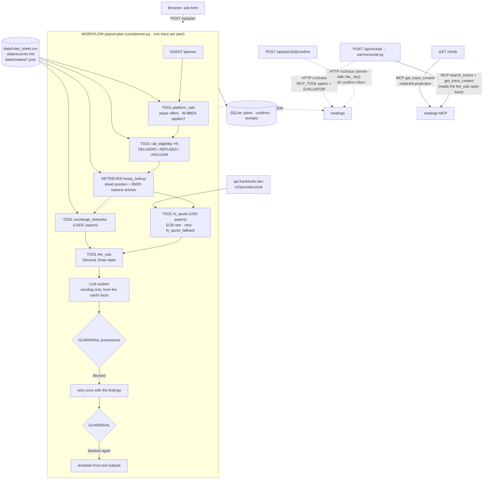

# Cair — architecture

Written from the code in this repository (`cair/`, `scripts/`). One process, one SQLite file, one LLM, three
neatlogs surfaces (SDK spans, HTTP `/v1/trace`, MCP read-back).

## The agent's task

*Get this payout to my bank account intact.* Input: who pays, how much, where the winner lives, which options the
payout form shows. Output: the route to pick (or a refusal), what goes on W-8BEN line 10, the withholding, what lands —
each figure footnoted to the tool span that produced it — and later, a check of what actually landed.



## Components

| File | Role |
|---|---|
| `cair/planner.py` | The agent. `payout_plan` (WORKFLOW) → `planner` (AGENT): runs the tools in a fixed order through `Attempts.call` (one retry, then a fallback or UNCLEAR), picks the route by code (`RAIL_PREFERENCE` over DELIVERS rails only), builds the card, asks the LLM to word it, runs the guardrail, retries once with the findings, falls back to a template. `render_text` produces the card text the eval scores. |
| `cair/tools.py` | Six tools, each a neatlogs span: `platform_rails`, `rail_eligibility`, `treaty_lookup` (RETRIEVER via `neatlogs.trace`), `fx_quote` + `fx_quote_fallback`, `exchange_networks`, `fee_calc`. `FORCE_FAIL` injects a failure for recovery runs. |
| `cair/rules.py` | Loads the rules sheet; refuses a fact cell filled twice or a fact with no source; most-specific row wins (`country,payer` > `country,*` > `*,payer` > `*,*`). |
| `cair/calc.py` | The only money arithmetic. `Decimal`, banker's rounding. Three-state on W-8BEN (YES withholds, NO does not, UNCLEAR makes the landed amount UNCLEAR with an upper bound). Blank is never 0. |
| `cair/treaty.py` | BM25 (`rank_bm25`) over the articles of each US treaty, extracted from the IRS PDFs by `scripts/extract_treaty.py`. |
| `cair/fx.py` | ECB-only rates; every success is snapshotted so a later failure can fall back to a real, dated ECB rate. |
| `cair/guardrail.py` | Provenance check (`check`) and its GUARDRAIL span (`run`): unsourced figures, endorsing a refused rail, an article on line 10, a withholding rate the tools did not produce. `no_source` blocks deterministically when nothing in the sheet covers the request. |
| `cair/figures.py` | What a figure is and when two match. Shared by the guardrail and the scorer. |
| `cair/reconcile.py` | Receipt check: MCP read-back of the plan's `fee_calc` span, full or partial comparison, EVALUATOR span over HTTP. |
| `cair/neat.py` | HTTP `/v1/trace` writer and MCP client (Streamable HTTP, project key). |
| `cair/app.py`, `cair/view.py`, `cair/templates/` | FastAPI routes, per-IP rate limits, session/end-user binding, server-rendered plan card, `/verify`, `/rules`. |
| `cair/labels.py`, `cair/scoring.py`, `scripts/eval.py` | Frozen-set labels from the sheet, U/P/K/N scoring, the eval runner (v1 baseline lives only here). |

## Trace shape (one plan)

```
WORKFLOW payout-plan                inputs: plan id, payer, country, amount, rails, exchange, origin, question
 └─ AGENT planner
     ├─ TOOL platform_rails
     ├─ TOOL rail_eligibility        × each offered rail
     ├─ RETRIEVER treaty_lookup      neatlogs.retriever.query / .documents
     ├─ TOOL fx_quote                (ERROR ×2 → TOOL fx_quote_fallback in a recovery run)
     ├─ TOOL exchange_networks       (USDC payers)
     ├─ TOOL fee_calc
     ├─ LLM qwen3.8-max              (wrapped OpenAI-compatible client)
     └─ GUARDRAIL provenance_guardrail   neatlogs.guardrail.passed / .score; verdict in the output
```

Session and end user are bound per request with `neatlogs.identify(session_id=…, end_user_id=<hashed cookie>,
end_user_metadata={"origin": …})`. Confirms and receipt checks are separate traces in the same session.

## Invariants (each has a test in `tests/`)

1. **Provenance** — every money amount, rate and treaty-article number in the explanation appears in a tool output of
   the same plan (`test_guardrail_blocks_unsourced_number`, `test_guardrail_allows_line_numbers`).
2. **Deliverability** — a REFUSED rail is never the recommendation (`test_refused_rail_never_recommended`).
3. **Line 10** — an article only when the sheet has a sourced article that covers the income; NONE → blank;
   otherwise UNCLEAR. Withholding only when the payer's own page says a W-8BEN applies
   (`test_line10_blank_without_article`, `test_line10_unclear_when_applicability_unsourced`,
   `test_no_withholding_unless_w8ben_applies`).
4. **UNCLEAR is terminal** — the model cannot upgrade an UNCLEAR line (`test_unclear_landed_cannot_be_upgraded_by_the_llm`).
5. **Frozen set integrity** — `eval.py` refuses to run if `data/frozen_set.jsonl` differs from tag `frozen-set-v1`.
6. **Public read-back is redacted** — `/verify` shows span names, kinds, status and durations only.

## Hosting

AWS EC2 t3.small (us-east-1), Ubuntu 24.04, `uvicorn` behind Caddy (automatic HTTPS) at
`https://app.cair.edycu.dev`, systemd unit, secrets in `/etc/cair/cair.env` (never in the repo). neatlogs is
initialised once in the FastAPI lifespan and flushed once at shutdown.
