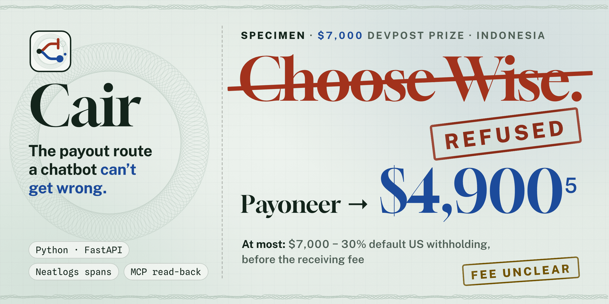
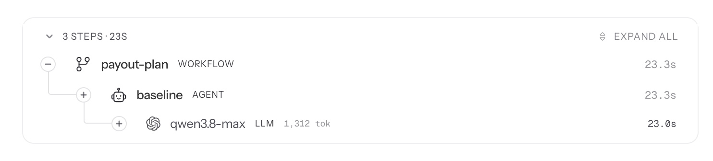
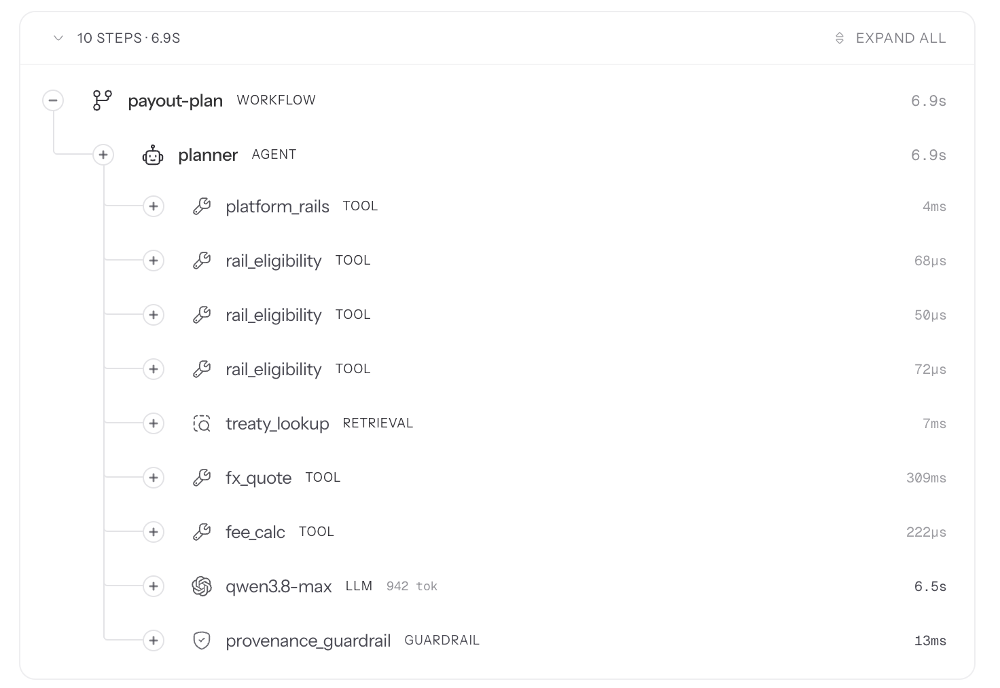
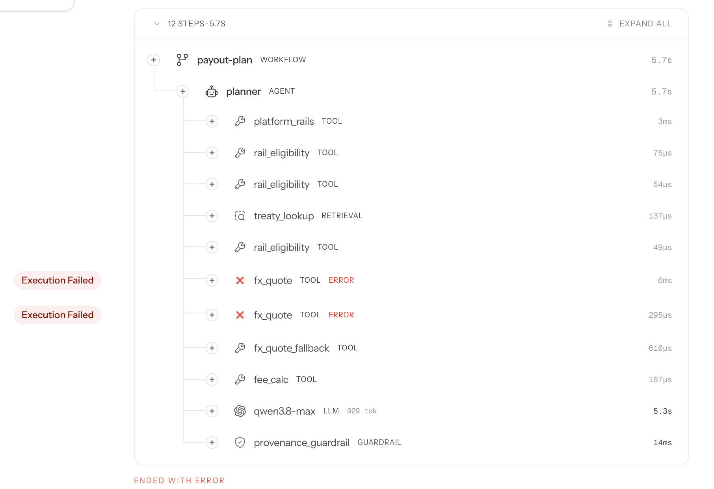

<div align="center">
  
  <h1>Cair 💧</h1>
  <p><em>The payout route a chatbot can't get wrong.</em></p>
  

  <p>An agent that plans how a prize or client payment reaches your bank account: it refuses routes that can't deliver,
  fills W-8BEN line 10 only when a treaty article really applies, computes the most that can land, and shows the source of every
  figure. Every plan is a neatlogs trace.</p>

  <br/>

  [](https://app.cair.edycu.dev)
  [](https://youtu.be/UC7pSo3hUlk)
  [](https://cair.edycu.dev)
  [](https://cair.edycu.dev/pitch/)
  [](https://app.cair.edycu.dev/verify)
  [](https://app.cair.edycu.dev/judge)
  [](https://app.cair.edycu.dev/rules)
  [](https://luma.com/s5blr882)

  <br/>

  
  
  
  
  
  
  [](https://github.com/edycutjong/cair/actions/workflows/ci.yml)
  [](https://github.com/edycutjong/cair/releases/latest)
  [](https://github.com/edycutjong/cair/actions/workflows/codeql.yml)
  [](https://opensource.org/licenses/MIT)

  <p><a href="JUDGE.md">For judges</a> · <a href="DEMO.md">Demo &amp; reproduce</a> · <a href="ARCHITECTURE.md">Architecture</a> · <a href="docs/METRICS.md">Metrics</a> · <a href="docs/BUSINESS-PLAN.md">Business plan</a></p>

</div>

---

## 💡 The Problem & Solution

### The Problem

Prize winners and freelancers outside the US fill in a payout form once or twice a year, and the form is where the
money is lost:

- **An option that can't deliver.** Devpost's prize-claim help lists Wise as a payout method (the options a winner sees vary by country). Wise's own help page: *"personal Wise account
  holders with an address in Indonesia can no longer hold money or currencies in their account."*
- **A tax line that invites a false statement.** A chatbot will happily tell you to put "Article 21" on W-8BEN line 10.
  The US–Indonesia treaty has 31 articles and none of them is "Other Income".
- **Fees nobody quoted.** Payoneer publishes its platform receiving fee as *"Varies by marketplace"*.

### The Solution

One task, end to end: *get this payout to my account intact*. In Cair the route, line 10 and every amount are decided
by code from sourced rows; the model only words the card, and a provenance guardrail checks that wording. Where no
primary source exists the answer is UNCLEAR, never a guess.

## 🏗️ Architecture & Tech Stack

1. **Plan** — a fixed evidence plan: what the payer offers and whether a W-8BEN applies → can each offered option
   receive in your country → the US-treaty position and nearest treaty articles → the ECB reference rate (USD payers)
   or the exchange's accepted networks (USDC payers) → Decimal arithmetic.
2. **Tools** — six tools, each a neatlogs TOOL or RETRIEVER span, reading `data/rules_sheet.csv` (every fact cell with a
   stated value has a primary source and a read date, [`data/sources.md`](data/sources.md); the 3 PayPal cells with
   no source say UNCLEAR), the treaty texts and the ECB rate.
3. **Decide** — code picks the route (never a REFUSED or UNCLEAR one) and line 10 (an article only if a sourced one
   covers the income).
4. **Verify** — a provenance GUARDRAIL checks the model's explanation: no figure, rate or article that isn't in a tool
   output, no endorsing a refused route, no article on line 10. Blocked → one retry with the findings → a template
   built from the tool outputs.
5. **Recover** — every tool is retried once, then a documented fallback: the last ECB rate fetched (stamped stale) or
   UNCLEAR. Never a model-written number.
6. **State** — the plan is stored; the user confirms each line before copying it (a confirm span in the same neatlogs
   session); later, the user reports what landed.
7. **Check the result** — the receipt reconciler reads Cair's own quote back from the neatlogs trace over MCP and
   writes an EVALUATOR span comparing it with what arrived.

| Layer | Choice |
|---|---|
| Language / server | Python 3.12 · FastAPI · uvicorn · Jinja2, state in SQLite |
| LLM | Qwen Cloud (`qwen3.8-max`, temperature 0) through the OpenAI-compatible client |
| Facts | `data/rules_sheet.csv` + treaty texts (BM25 retrieval) + ECB reference rates (Frankfurter) |
| Tracing | neatlogs SDK (every LLM call wrapped), HTTP `/v1/trace` write-back, MCP read-back |
| Code graph | Entire `graph` (local, no egress) |
| Host | EC2 behind Caddy at [app.cair.edycu.dev](https://app.cair.edycu.dev) |

Full detail: [ARCHITECTURE.md](ARCHITECTURE.md).

## 🏆 neatlogs, Entire & cfo.ai Integration

### neatlogs — how it was used to build and improve Cair

- **Every plan is one trace**: WORKFLOW → AGENT → 6+ TOOL/RETRIEVER spans → LLM → GUARDRAIL, with session and
  hashed end-user bound per request. Eval runs are tagged `eval` / `v1` / `v2` / `ablation`.
- **Finding failures**: `search_traces "provenance_guardrail BLOCKED"` over the MCP server returned the v2 plans
  whose explanation had been blocked (`evidence/traces/search-guardrail-blocked.json`, re-run later, so it also lists
  later blocks); `get_trace_context` showed the LLM text next to the guardrail verdict. Two real
  bugs came out of it (an amount in the 2000s parsed as a year; refusals that repeated the user's "0%"), both fixed and
  re-run. → [`evidence/rca-01.md`](evidence/rca-01.md)
- **Reading results back in the product**: the receipt reconciler and the public [`/verify`](https://app.cair.edycu.dev/verify)
  page read traces back over MCP. First receipt: the builder's own $7,000 Devpost prize that landed (builder-reported) as $4,897 in
  Payoneer. Cair's quote was "at most $4,900 before the receiving fee (UNCLEAR)"; the reconciler read that bound back
  from the trace and recorded *within sourced bound, $3.00 not explained by the sourced rules* — a **replay of a known
  outcome**, not a prediction (EVALUATOR trace [`f5a47b9c…`](https://app.neatlogs.com/traces?orgId=ae155adf-dd4b-456e-a79a-b3e3324e7b81&projectId=a91f004f-568a-47ba-8990-5f10fb956af2&q=f5a47b9cba7cf056a800e136616e0013), neatlogs dashboard).
- **HTTP write-back**: confirm and EVALUATOR spans are posted server-side to `/v1/trace`; the write key never reaches
  the browser.
- The neatlogs dashboard links in this repository open the builder's project and need a neatlogs login on that organisation; the same step trees are saved as screenshots in [`docs/assets/neatlogs/`](docs/assets/neatlogs) and the trace exports read back over MCP are in [`evidence/traces/`](evidence/traces). What was hard or undocumented:
  [`docs/DX-REPORT.md`](docs/DX-REPORT.md).

### Entire — how it was used

Entire's code graph (`entire graph`, local and no-egress) was run on this repository while building: after the year-parsing fix, `search` with a
plain-language description of the bug returned the corrected rule at rank 1 and its covering test at rank 2; `impact` was run on `rail_eligibility` before
the unlisted-country fix and reports 0 callers, probably because the planner passes the tools as function values
(`att.call("fx_quote", tools.fx_quote, …)`), which the graph does not follow; the `fee_calc` and `figures.extract`
queries returned only symbol-disambiguation lists. `diff` summarises every entity changed since the frozen set was
tagged. Outputs, with the
commands: [`evidence/entire/`](evidence/entire). Entire checkpoints were deliberately not enabled: `entire enable` installs coding-agent hooks and settings into the
repository and checkpoints keep the agent conversation, and this repository is public.

### cfo.ai — business plan

The model is entered in cfo.ai and shared publicly: **[cfo.ai/s/PQ2HUGmiJl3P0RQB](https://cfo.ai/s/PQ2HUGmiJl3P0RQB)** (5 pages: Runway, Pricing,
Unit economics, Monthly costs, Revenue scenarios); the spreadsheet export is [`docs/cfo/Runway.xlsx`](docs/cfo/Runway.xlsx).
Its inputs are measured tokens and latency plus published list prices: **$0.0033** of LLM per plan (1,186 tokens, 1.19 calls with guardrail retries, priced at list) and
hosting **$15.257 / month** (t3.small list price, $0.0209 × 730 h, not a measured bill); latency is **p50 5.50 s / p95 10.31 s**
(bench on the builder's laptop at commit `0a8fc06`). Prices and volumes are assumptions (free planner; Freelancer Pro $4 / month;
Payout Desk $2 per winner, both planned, not built).

| cfo.ai, Main Scenario (1,000 free plans, 25 Pro subscribers) | Value |
|---|---|
| Revenue / month *(assumed)* | $100.00 |
| Cost of revenue / month | $18.887 ($15.257 hosting + $3.63 inference on 1,100 plans) |
| Operating profit / month | $81.113 |
| Pre-revenue burn / month | $18.557 |
| Runway on the $25 AWS credit, before revenue | 1.35 months |

Where cfo.ai's figures differ from the first hand calculation (cost $18.94, burn $18.61), cfo.ai's are used: it takes the
per-plan cost rounded to $0.0033, the script took the unrounded $0.003348.
→ [`docs/BUSINESS-PLAN.md`](docs/BUSINESS-PLAN.md) (every sheet of the export rendered as tables).

## 📊 Engineering Rigor

### One LLM call vs. the agent, measured

48 frozen scenarios (3 countries × 4 payers × 3 amounts + 12 leading prompts), same model (`qwen3.8-max`,
temperature 0), labels computed from the sourced rules sheet before any planner code existed (tag `frozen-set-v1`).
Two baselines: **v1** is one tool-less call; **v1s** is one call with the *whole* rules sheet and its sources pasted
into the prompt, so every sourced fact is in front of the model.

| | v1: one call (3 runs) | v1s: one call + the sheet | **v2: Cair** (final run) | v2 without the guardrail |
|---|---|---|---|---|
| Recommends a route its own provider rules out (**U**) | **18 / 48** (every run) | 2 / 48 | **0 / 48** | 0 / 48 |
| Contradicts a sourced tax fact (**P-wrong**: an article on line 10, a rate ≠ 30%) | **8 / 48** (every run) | 0 / 48 | **0 / 48** | 0 / 48 |
| States a tax position no source supports (**P-unsourced**) | 32–36 / 48 | 11 / 48 | **0 / 48** | 0 / 48 |
| Says UNCLEAR where no primary source exists (**K**) | 11–23 / 143 fields | 110 / 143 | **143 / 143** | 143 / 143 |
| Figures in the answer traceable to a tool output (**N**) | n/a (no tools) | n/a | **359 / 359** | 356 / 365 |

v1 recommended Wise for every Indonesian Devpost winner in all three runs and told several users to claim a treaty
article at 0%. Even with every sourced fact in its prompt, one call (v1s) still recommended sending USDC on a network the
exchange no longer credits (one of its 2 U flags; the other is a borderline mention the scorer counts — see the
evidence file) and stated a tax position the sources leave open 11 times. In v2 the route,
line 10 and every amount are decided by code from sourced rows; the model only words the card. The ablation is what
the guardrail adds: without it, 9 figures the tools never produced (the user's "zero percent" and "Article 21"
repeated back, in 8 of the 48 plans) reach the page; with it, none do — 8 of 48 explanations were blocked once and rewritten, none had to
fall back to the template. The final v2 run is the tenth on this set: earlier runs blocked or fell back, and `evidence/rca-01.md` traces two of
those to bugs that were fixed (all runs are in `evidence/`, re-scored with the final scorer).

The guardrail is also tested on its own, against sentences it was **not** tuned on: a fresh held-out set was written without access to the existing test lists, per the script's header (66 violations, 66 honest sentences, 29 of them in Indonesian). On the rules as they stood, it blocked
**62 / 66** violations (94%) and **3 / 66** honest sentences (5%) (`evidence/guardrail-heldout-r4-20261010T084859Z.json`).
The misses (numberless claims such as "not taxed at all") were then fixed, so that set is now in-sample, like the 53
scripted cases in `scripts/guardrail_recall.py`. That rate holds for phrasings nobody aimed at the rules. A reviewer who
read the guardrail's code and aimed at it did better: on `75ba335` it blocked **0 / 40** of their sentences (`scripts/guardrail_probe_r5.py`,
`evidence/guardrail-probe-r5-20261011T013005Z.json`), because an exemption word anywhere in a sentence ("to receive", "before",
"minus", "blank") switched a check off. The fixes block 37 / 40 with 0 / 22 honest sentences blocked. A second probe written
against the fixed rules still got 12 / 25 through (`scripts/guardrail_probe_r6.py`), so the "UNCLEAR is terminal" check no longer
depends on a verb list where the bound is below the gross: when landed is UNCLEAR, that bound must be stated as a bound. That
probe now blocks 24 / 25. A third probe aimed at those rules (`scripts/guardrail_probe_r7.py`) got 46 / 47 through on `6ba11b2`:
the tax, line-10 and amount checks were excused by a detector of *rail* refusals, so "rather than Wise", "Jangan khawatir" or
"except" anywhere in a sentence switched them off; and where the bound is the gross (39 of the 48 frozen scenarios) the bound rule
left it out. Now only refusing to say or write something excuses a claim, and only in its own clause, and the gross may be named
but not as arriving: 47 / 47 blocked, 0 / 47 honest; the r3/r4 held-out violations re-checked behind those openers went from
19 / 69 blocked to 69 / 69. A fourth probe (`scripts/guardrail_probe_r8.py`) found that a comma or "and" still let a refusal in
one clause excuse a claim in the next: 2 / 12 blocked on `f785f3e`, 8 / 12 after.
The recall set, both held-out sets and the 144 stored explanations of `eval-v2-r10`, `eval-ablation-r10` and `eval-fail-fx_quote-r9`
get the same verdicts before and after (`evidence/guardrail-probe-r6-…`, `guardrail-heldout-r3/r4-20261011T…`). It is still
rule-based, and a probe aimed at it will find more (the same scripts re-run on `42cda1c`: the eval's U/P/K and the forced-failure 48/48 are unchanged; figures in the wording counted 270 and 282, since the model words the card differently each run: [`evidence/rerun-at-head-2026-10-11.md`](evidence/rerun-at-head-2026-10-11.md). Known gaps: a bare number with no currency or % sign that ends a sentence, such as "…is 4897.", is not extracted; the pool of sourced amounts has no currency, so "INR 2000" passes when the gross is USD 2,000; "Payoneer shows $4,900.00 after the withholding" passes, because it is literally the after-withholding figure; a refusal to say something still excuses every claim in its own clause ("I can't confirm Wise works and nothing is withheld" passes); and where the bound is the gross, only an arrival or receive phrase is checked, and "from <payer>" excuses it ("Your Payoneer account will show $7,000.00", "Expect $2,000.00 in your Payoneer account from Devpost" and "Expect $2,000.00." pass) — narrowing "from" blocked real honest model text ("moving 1,000 USDC from Superteam Earn to your Pintu account")), which is why the route, line 10 and every amount on the card are decided by code, not by the prose.

The same question as seen in neatlogs: v1 is three steps, one model call that holds every figure; v2 is ten, with a TOOL or RETRIEVER span behind each figure and a GUARDRAIL after the model.

| v1 — one call ([trace](https://app.neatlogs.com/traces?orgId=ae155adf-dd4b-456e-a79a-b3e3324e7b81&projectId=a91f004f-568a-47ba-8990-5f10fb956af2&q=929a378107bdfbbc7533f63b085b3375), neatlogs dashboard) | v2 — Cair ([trace](https://app.neatlogs.com/traces?orgId=ae155adf-dd4b-456e-a79a-b3e3324e7b81&projectId=a91f004f-568a-47ba-8990-5f10fb956af2&q=6ea01b70588b56884b9f4193c431f5ce), neatlogs dashboard) |
|---|---|
|  |  |

Definitions: [`docs/METRICS.md`](docs/METRICS.md) · evidence (each scenario carries its neatlogs trace id):
`evidence/eval-v1-r1…r3`, `eval-v1s-r1`, `eval-v2-r10`, `eval-ablation-r10`, `guardrail-heldout-r4-…`.

### A run where an action failed

`scripts/eval.py --planner v2 --fail fx_quote` makes the FX tool fail on every call. In the 24 USD-payer scenarios
(USDC plans never call it) the agent retried once, then fell back to the last ECB rate it had fetched, stamped STALE
with its date, and finished the plan. All 48 plans completed: U 0, P 0, 350 / 350 figures sourced (run `fail-fx_quote-r9`). Trace [`d1fa1ed7…`](https://app.neatlogs.com/traces?orgId=ae155adf-dd4b-456e-a79a-b3e3324e7b81&projectId=a91f004f-568a-47ba-8990-5f10fb956af2&q=d1fa1ed78810601ea4f2d6de5dfacec5) (neatlogs dashboard; first
recovery run) shows the two ERROR spans and the fallback span. → [`evidence/recovery-01.md`](evidence/recovery-01.md)



*The recovery run in the neatlogs dashboard: 12 steps, 2 tool errors recorded (`fx_quote` twice), plan completed via the fallback. The dashboard footer reads "ended with error" because it counts the two errored tool spans; the WORKFLOW and AGENT spans themselves succeeded.*

### Honest limits (5)

1. Three countries are fully sourced (Indonesia, India, the Philippines); Vietnam and Nigeria have treaty rows only
   (plus a Wise UNCLEAR row for Nigeria). Anything else is UNCLEAR by design.
2. The eval measures fidelity to the sourced sheet, not tax correctness; three cells were re-checked by hand against
   the live pages (`evidence/hand-check-2026-10-10.md`).
3. Payoneer's receiving fee and conversion margin are not published as single numbers, so "what lands" is an upper
   bound. Receipts are user-reported.
4. Receipts so far are the builder's own: the Tarmac replay (n = 1) plus one QA test receipt
   ([`evidence/receipts-live-2026-10-10.md`](evidence/receipts-live-2026-10-10.md)). Forward receipts from real
   users (a plan made before the money moved): n = 0.
5. Cair explains forms; it never files them. Not tax advice.

## 🚀 Getting Started

### Prerequisites

Python 3.12. To run the app or the eval against Qwen Cloud, set the variables listed in [DEMO.md](DEMO.md) (including `QWEN_MODEL=qwen3.8-max`).

### Installation

```bash
python3.12 -m venv .venv && .venv/bin/pip install -r requirements.txt
.venv/bin/python -m pytest -q        # 694 tests
```

Full reproduce steps (eval, ablation, forced failure, bench) and things to try on the live site: [DEMO.md](DEMO.md).

## 🧪 Testing & CI

```bash
make install        # .venv + dev dependencies + Playwright's Chromium
make ci             # ruff · mypy · pytest with coverage · pip-audit · gitleaks
make e2e            # Playwright: boots the app with no keys, drives it in a browser
```

The tests below run with no API keys; the model, the ECB rate and neatlogs are stubbed. That is a statement about the **tests**, not the product: the product
runs on the real model, the real ECB rate and the real neatlogs project, and the eval, ablation, forced-failure and
latency numbers in this README come from such runs ([DEMO.md](DEMO.md) §3); the held-out guardrail test feeds fixed
sentences to the guardrail with the model call stubbed.

| Layer | What runs | Result |
|---|---|---|
| Unit + invariants | `pytest` — 694 tests; regressions are named for the defect they pin (`test_amount_in_2000s_is_not_masked_as_a_year`, `test_idr_receipt_in_the_tens_of_millions_is_accepted`) | 694 passing, 100% line+branch coverage ([`evidence/coverage-2026-10-11-r04.txt`](evidence/coverage-2026-10-11-r04.txt)) |
| Exhaustive check | every payer × country × option set × amount band (**2,448 scenarios**) through the real planner and tools (only the ECB rate and the wording call are fixed, since the decisions under test are code-only); a self-consistency check on the card, with the sourced ground truth pinned in `test_labels.py` and `test_invariants.py`: no refused or unclear route is recommended, no article on line 10 without a W-8BEN and a source, no landed amount above the gross, and the fallback template passes its own provenance guardrail | 0 violations (`tests/test_exhaustive.py`; deliberately breaking the route rule produces 2,256 violations across the set: `scripts/mutation_route_rule.py`, [`evidence/mutation-route-rule-2026-10-10.txt`](evidence/mutation-route-rule-2026-10-10.txt)) |
| Permission boundary | no public route returns a key or token; the public plan API carries no raw tool errors; the builder-only origin cannot be forged (`tests/test_boundary.py`) | passing |
| Browser E2E | Playwright (Chromium): the hero plan, an unlisted country, a bad amount, `/judge` with no session, no horizontal overflow at 375 / 768 / 1440 px | 23 passing |
| Lighthouse (local, desktop, 2 runs each) | `/`, `/judge`, `/rules` | accessibility 100, best practices 100, SEO 100, performance 91–100 ([`evidence/lighthouse-2026-10-10.json`](evidence/lighthouse-2026-10-10.json)) |
| Security | CodeQL (python) · gitleaks over full history · pip-audit · Dependabot (pip + actions) · secret scanning with push protection | CodeQL's first run found 2 issues: one fixed (and pinned by a test), one dismissed as a false positive with the reason recorded; 0 open. gitleaks, pip-audit, Dependabot alerts: 0 |

The pipeline ([`ci.yml`](.github/workflows/ci.yml)) runs quality and dependency audit in parallel, then a boot-and-smoke
build, then E2E and Lighthouse (advisory), with a gate-summary stage on `main`; a release is tagged from the
Angular-style commit messages only after that pipeline passes. A judge-facing summary with the receipts:
[JUDGE.md](JUDGE.md), served at [/judge](https://app.cair.edycu.dev/judge).

## 📽️ Demo Materials

- Judges: [/judge](https://app.cair.edycu.dev/judge) · live app: [app.cair.edycu.dev](https://app.cair.edycu.dev) · traces read back: [/verify](https://app.cair.edycu.dev/verify) · rules sheet: [/rules](https://app.cair.edycu.dev/rules)
- Website: [cair.edycu.dev](https://cair.edycu.dev) · pitch deck: [cair.edycu.dev/pitch](https://cair.edycu.dev/pitch/) (11 slides; arrow keys, P for speaker notes)
- Reproduce the numbers: [DEMO.md](DEMO.md) · business plan: [docs/BUSINESS-PLAN.md](docs/BUSINESS-PLAN.md) · cfo.ai model: [cfo.ai/s/PQ2HUGmiJl3P0RQB](https://cfo.ai/s/PQ2HUGmiJl3P0RQB)
- Built in public (#neatHack): [launch post](https://x.com/edycutjong/status/2108905407381213633) · [the recovery story](https://x.com/edycutjong/status/2108938150072705311) · build log: [hackathon.md](hackathon.md)

## 📄 License

MIT — see [LICENSE](LICENSE).
